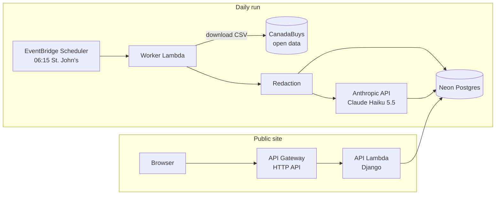

# NL Public Tender Radar

Eligibility triage for Canadian federal tenders: can a small St. John's IT firm even bid?

**Live:** https://h70n8j46yk.execute-api.us-east-2.amazonaws.com/
(the first load after a quiet period can take about 9 s while the Lambda starts; a fix is planned).

## The problem

Federal tender notices often hide hard blockers: bidding limited to existing supply-arrangement
holders, security clearances, or on-site work outside Newfoundland and Labrador. These are
written as free text, often only in attached documents. Keyword alerts can match "security
clearance" but can't tell "you can't bid" from "the notice doesn't say".

## What it does

1. **Ingest:** a daily job downloads the CanadaBuys open-data CSVs and keeps notices delivered
   in NL plus national or NL-scoped IT notices.
2. **Redact:** contact names, emails and phone numbers are removed before anything is stored.
3. **Extract:** an LLM reads each redacted notice and fills six gates (supply arrangement,
   supplier origin, clearance, on-site work location, land claims, documents behind a login),
   each with an exact quote from the notice as evidence. Code checks every quote against the
   notice; a value whose quote isn't there is reset to `unknown`.
4. **Decide:** plain Python rules (not the LLM) compare the gates with the profile of a
   **fictional** firm, Harbourline Software (no supply arrangements, no clearances), and give
   one of three statuses:
   - **blocked**: the notice states a requirement the firm can't meet (a supply arrangement
     it doesn't hold, a corporate or Secret-level clearance, on-site work outside NL);
   - **check solicitation**: no blocker found, but the notice says its criteria are in the
     solicitation documents;
   - **no blockers stated**: the notice states its criteria and none block; gates it doesn't
     mention are listed as "not stated".

The LLM never makes the decision. It only extracts quoted facts; the status comes from
versioned, unit-tested rules. Where CanadaBuys metadata already says a notice is "against a
supply arrangement", that metadata overrides whatever the LLM extracted.

## Architecture



- **Backend:** Python 3.12, Django 5.2, server-rendered pages (no JavaScript on public pages).
- **LLM:** `claude-haiku-5-5`, structured outputs, effort low, max 2000 tokens.
- **Database:** Neon Postgres (free tier), pooled connections from Lambda.
- **Infra:** AWS Lambda (arm64 container images, ECR), API Gateway HTTP API, EventBridge
  Scheduler, SSM Parameter Store, CloudWatch Logs. All Terraform; no VPC, NAT or RDS.
- **CI:** GitHub Actions: ruff, Django checks, pytest against a throwaway Postgres,
  gitleaks over the full history, `terraform fmt`/`validate`.

## Evaluation

The question: does the LLM extract the gates better than a keyword baseline, and does the
final status match what a human would decide?

**Protocol** ([docs/eval-protocol.md](docs/eval-protocol.md))

- **Frozen before labelling:** prompt `v2`, schema `1`, the keyword baseline `rules-v1` and
  eligibility rules v3 are pinned by hash in a test, so any change fails CI. Changes after
  labelling must ship as new versions.
- **Seeded selection:** 30 notices picked by a script (seed 20261116) with minimum quotas for
  the hard cases (supply arrangements, clearances, land claims, NL vs national, open vs
  expired): 10 dev, 20 test.
- **Blind hand labels:** each gate labelled from the redacted notice with a written guide,
  without seeing any model output. The expected status is derived from the labels by the same
  rules, not labelled directly. 5 of 10 dev cases are marked unsure.
- **n = 10 (dev only so far).** The LLM was run once (cached) plus 3 uncached repeats per case.

**Per field, correct out of 10** (after the grounding check, i.e. what the site shows)

| Field | LLM | Keyword baseline |
|---|---|---|
| criteria_location | 8 | 8 |
| supply_arrangement_required | 4 | 9 |
| supplier_origin_restriction | 9 | 6 |
| clearance.corporate | 10 | 9 |
| clearance.personnel | 10 | 9 |
| work_location.on_site | 9 | 6 |
| land_claims_applies | 10 | 10 |
| documents_behind_login | 7 | 6 |
| **All fields** | **67/80** | **63/80** |
| All fields, excluding unsure cases | 35/40 | 30/40 |

Errors: the LLM missed 9 known values and overclaimed 2 (gave a value the notice doesn't
state); the baseline missed 8, overclaimed 4 and was wrong 5 times.

**Status (can-bid decision):** both systems agree with the labels on **6/10**, and neither
produced a **false block** (0 for each). The misses go the safe way: the LLM missed 3 blocks
and the baseline 2, each landing on "check solicitation" rather than "no blockers".

**Consistency:** across the 4 LLM runs per case, the status was the same in **8/10** cases.

**Cost:** the whole dev eval (37 API calls) cost about **$0.04**. The baseline is free.

**What this does and doesn't show.** With 10 cases, one case is 10 points and the 95%
intervals overlap almost everywhere (6/10 is 31–83%). The dev split shows where each system
fails; it does not rank them. The 20-case blind test set, labelled before any scoring and
never used for tuning, is scored next.

Full report: [eval/reports/dev-2026-11-17.md](eval/reports/dev-2026-11-17.md) (per-case
disagreements with evidence quotes; same data in `.json`).

## Findings

- **Most notices push their criteria into attached documents.** On the production run of
  2026-11-16, 72 of 88 open notices were "check solicitation" (14 blocked, 2 no blockers
  stated), and 8 of the 10 dev notices were labelled `see_solicitation`. For these, "check solicitation" is the honest answer, and the
  tool's value is narrowing the list rather than clearing notices.
- **The LLM is weak on supply arrangements.** 4/10 against the baseline's 9/10. It left the
  gate unknown even when the notice type itself said "Request for Standing Offer" or "Request
  for Supply Arrangement", and twice its quote failed the grounding check. This gate accounts
  for 2 of its 3 missed blocks (dev-02, dev-09) and is the main target for prompt v3.
- **The baseline overclaims supplier origin from trade agreements.** It read any named trade
  agreement (CPTPP, WTO GPA, bilateral FTAs) as an origin restriction: 4 overclaims, where the
  LLM made 1.
- **The baseline misses on-site work written in plain language** ("snow clearing services at
  the St.John’s Research and Development Centre"): 3 misses where the LLM was right.
- **Exclusion wording fools both systems.** On notice `cb-8448-42897985` (seen on the live
  detail page; not an eval case, and excluded from selection for that reason), both the LLM
  and the baseline read "excludes locations in areas subject to Comprehensive Land Claims
  Agreements" as land claims *applying*. The label guide treats this wording as `no`.
  This is one observation, not an eval metric.
- **Run-to-run variance shows up as value↔unknown flips.** Every gate that changed between runs
  moved between a value and `unknown`; none flipped between two values (e.g. yes↔no). Status
  flips follow from those (dev-02 went blocked ↔ check solicitation as its supply-arrangement
  gate flipped).

## Safety and cost

- **Contacts are redacted before storage**, so the database and the LLM only ever see redacted
  text. An independent audit command (`audit_redaction`) scans stored titles and descriptions
  for every contact in the raw CSVs, using its own detectors rather than the redactor's, and
  reports only counts and reference numbers.
- **Notice text is treated as untrusted:** it sits inside `<notice>` delimiters with angle
  brackets escaped, the prompt says it's data, not instructions (and asks the model to flag
  injection attempts), the output must match a JSON schema, and every evidence quote must appear
  in the notice or the gate is reset to `unknown` (6 gates were reset in the dev run).
- **Strict CSP:** public pages load one same-origin stylesheet and no scripts
  (`default-src 'none'`), with `frame-ancestors 'none'`.
- **No long-lived keys:** Lambdas use IAM roles, deploys use short-lived `aws login`
  sessions, and CI holds no AWS credentials.
- **Secrets live in SSM SecureStrings** created by hand; Terraform knows only their names, so
  the values never reach Terraform state or the repo.
- **LLM spend is capped** per run (50 calls by default) and per day ($0.15 on the deployed
  worker), checked before every API call.
- **Cost:** total LLM spend to date is under $0.25 (about $0.22 across all dev, production and
  eval runs). AWS is estimated at $0–1/month (mostly free tier); Neon is on its free tier.
  See the cost table in [infra/README.md](infra/README.md).

## Limits

- One fictional firm profile; no real users or client data.
- Federal notices from CanadaBuys only; no provincial or municipal sources.
- No attachment parsing, so most notices end at "check solicitation".
- LLM output varies run to run (status stable in 8/10 dev cases).
- Small evaluation: 10 dev cases scored so far; the 20-case test set is next.

## Run it locally

Needs Python 3.12 and a Postgres database. Put `DATABASE_URL` and `DJANGO_SECRET_KEY` in a
`.env` at the repo root (and `ANTHROPIC_API_KEY` only if you want real LLM calls).

```sh
python -m venv .venv && source .venv/bin/activate
pip install -r requirements-dev.txt
cd backend
python manage.py migrate
python manage.py ingest_canadabuys --url-defaults --save   # download + redact + store
python manage.py extract_tenders --status Open --baseline  # free; drop --baseline for the LLM
python manage.py assess_tenders
python manage.py runserver
cd .. && python -m pytest
```

Deploying to AWS: see [infra/README.md](infra/README.md).

## Data licence

Contains information licensed under the
[Open Government Licence – Canada](https://open.canada.ca/en/open-government-licence-canada).

Harbourline Software is a fictional firm used only as the eligibility profile.

## Roadmap

- Score the 20-case blind test set (prompt v2, baseline, rules v3).
- Prompt v3, aimed at supply arrangements and origin; scored as a new version on test.
- Prompt-injection test cases.
- Fix the cold start on the first page load.
