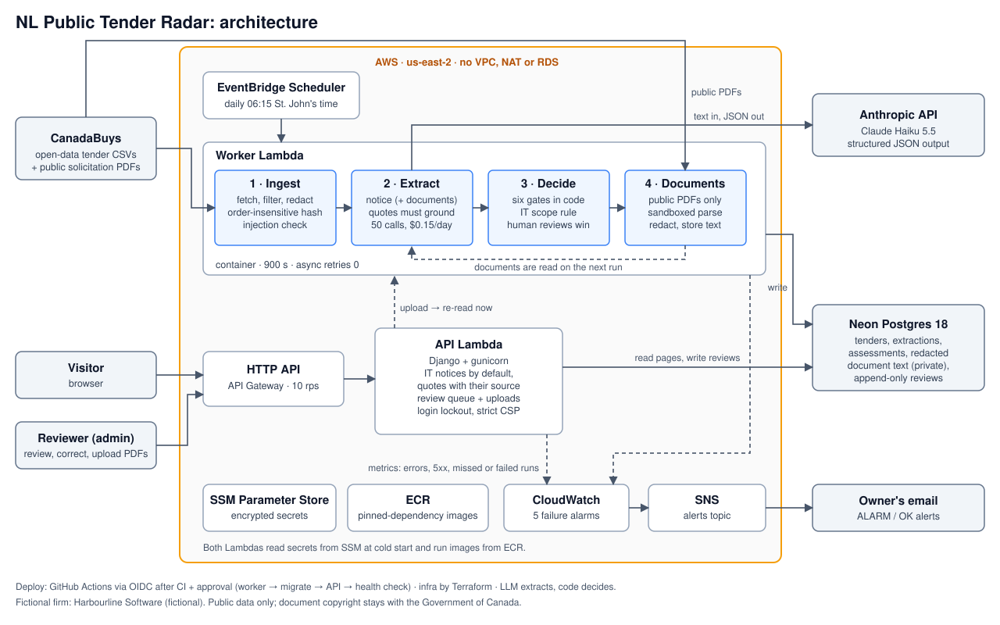
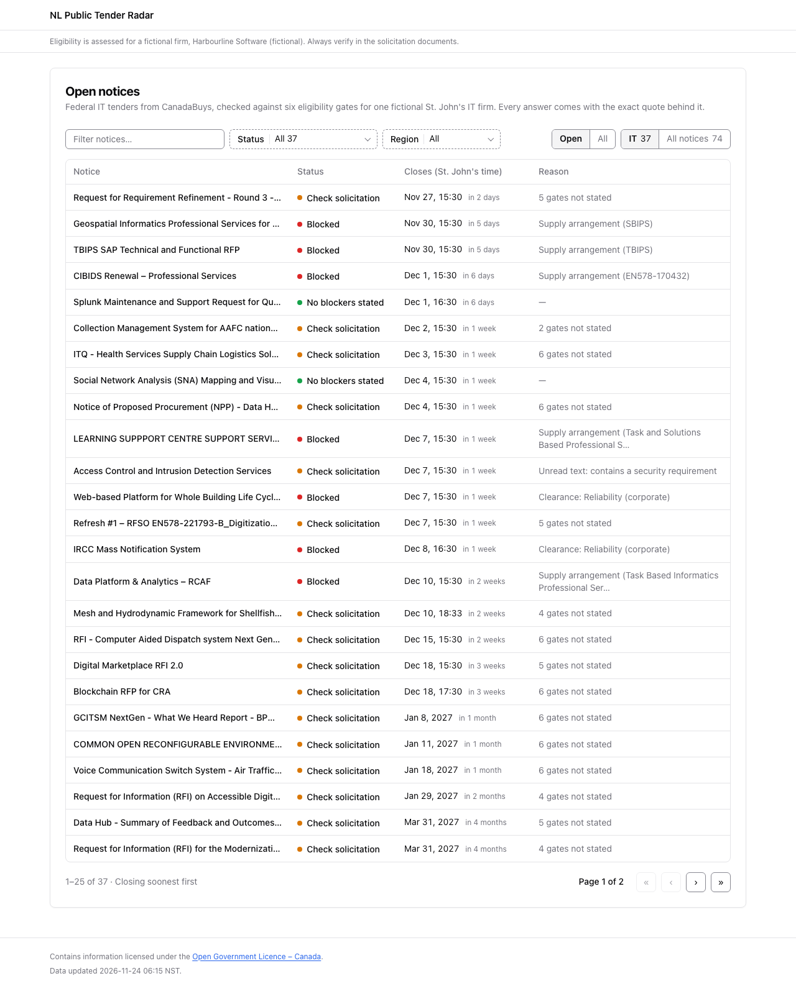
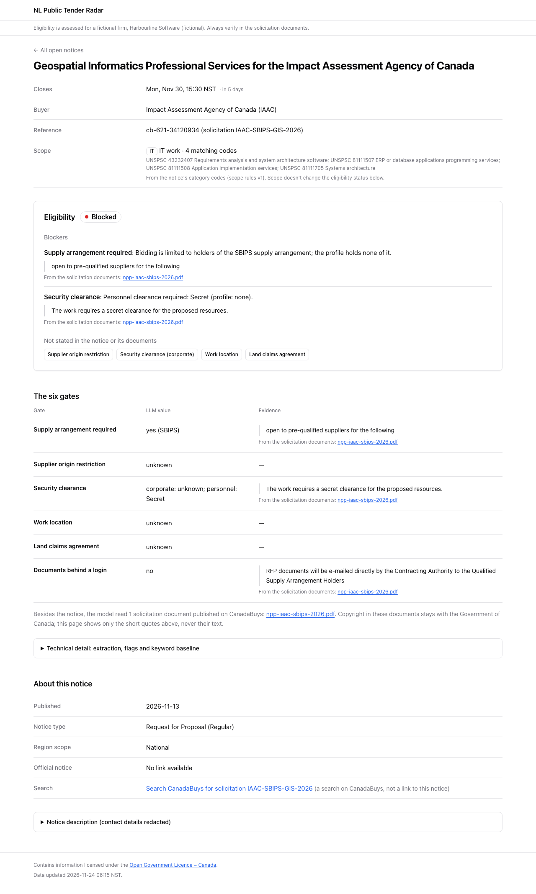
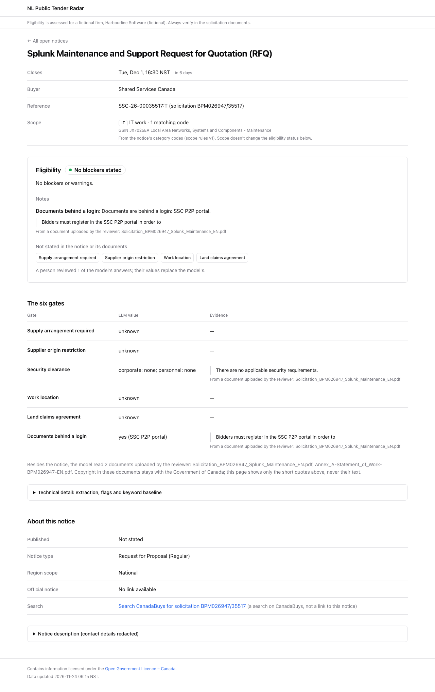

# NL Public Tender Radar

Federal IT tenders from CanadaBuys, triaged for one fictional St. John's IT firm: blocked,
check the solicitation, or no blockers stated, with the exact quote behind every answer,
including from the solicitation documents. An LLM only extracts quoted facts; plain,
versioned Python rules make the decision.

**Live:** https://h70n8j46yk.execute-api.us-east-2.amazonaws.com/
(a cold start takes 1.3–2.1 s; see Performance below).



| The list (IT notices) | A blocked notice | No blockers stated |
|---|---|---|
| [](docs/screenshots/list.png) | [](docs/screenshots/cb-621-34120934.png) | [](docs/screenshots/SSC-26-00035517-T.png) |

## The problem

Federal tender notices often hide hard blockers: bidding limited to existing supply-arrangement
holders, security clearances, or on-site work outside Newfoundland and Labrador. These are
written as free text, often only in attached documents. Keyword alerts can match "security
clearance" but can't tell "you can't bid" from "the notice doesn't say".

## What it does

1. **Ingest:** a daily job downloads the CanadaBuys open-data CSVs and keeps notices delivered
   in NL plus national or NL-scoped IT notices.
2. **Redact:** contact names, emails and phone numbers are removed before anything is stored.
3. **Extract:** an LLM reads each redacted notice and fills six gates (supply arrangement,
   supplier origin, clearance, on-site work location, land claims, documents behind a login),
   each with an exact quote from the notice as evidence. Code checks every quote against the
   notice; a value whose quote isn't there is reset to `unknown`.
4. **Decide:** plain Python rules (not the LLM) compare the gates with the profile of a
   **fictional** firm, Harbourline Software (no supply arrangements, no clearances), and give
   one of three statuses:
   - **blocked**: the notice states a requirement the firm can't meet (a supply arrangement
     it doesn't hold, a corporate or Secret-level clearance, on-site work outside NL);
   - **check solicitation**: no blocker found, but the notice says its criteria are in the
     solicitation documents;
   - **no blockers stated**: the notice states its criteria and none block; gates it doesn't
     mention are listed as "not stated".

The LLM never makes the decision. It only extracts quoted facts; the status comes from
versioned, unit-tested rules. Where CanadaBuys metadata already says a notice is "against a
supply arrangement", that metadata overrides whatever the LLM extracted.

## Scope

Ingest keeps every notice delivered in NL, whatever it buys (snow clearing, ship valves,
catering), so the site also says whether a notice is IT work at all. **Scope rules v1**
(`backend/tenders/scope.py`, pinned by hash) decide from the notice's UNSPSC and GSIN
category codes only, with no LLM:

- **IT work:** at least one code in an IT family: UNSPSC 43 (IT and telecom equipment and
  software), 8111 (computer services), 8116 (IT service delivery, cloud), 8311
  (telecommunications services), 451119 (audio and video conferencing); GSIN D302, N70, JX70,
  WL70, D304, D316, D399.
- **Exclusions inside those families:** UNSPSC 811119 (information retrieval and online
  database services: on the 2026-11-19 data these were purchases of data, such as satellite
  imagery and subscriptions), 811623 (business process as a service), and TV and radio
  broadcasting (831118, 831119).
- **Outside IT work:** codes present, none in an IT family. **Unknown:** no code at all.

Scope is a separate line on each notice and never changes the eligibility status. The list
shows IT notices by default, with an "IT | All notices" toggle.

**On 2026-11-19:** of 80 open notices, **41 IT, 39 outside, 0 unknown** (every notice had a
code). National notices: 39 of 47 IT; NL notices: 2 of 33.

**Known edge cases.** One IT code is enough, so a notice that lists IT among other goods is
in scope and a person reads it. That puts "Security Equipment" and "Access Control and
Intrusion Detection Services" in scope (through network security equipment, 43222500), and
"Energy Efficiency Regulated Products Testing" (one IT code among 27). "Internal
Communications System – Zenitel Marine Components", a ship's intercom, stays out: its codes
are in no telecom family.

## Human review

- **Review queue:** staff accept, correct or reject each gate in the admin, blocked and
  flagged notices first. A correction must be an allowed schema value with evidence that
  passes the same grounding check as model output, against the same input the extraction
  read: the notice, or with documents (v5) the notice and the documents it was given, with
  the document a quote is in found and named as for a model quote.
- **Overrides the model, not the rules:** the decision replaces the model's value before the
  frozen rules run.
- **Append-only:** decisions are never edited or deleted (model, queryset and a Postgres
  trigger); a newer decision supersedes an older one.
- **Carried over to re-extractions** of the same notice:
  - same LLM input: the decision carries;
  - a correction: carries if its quote still grounds in the new text;
  - an accept or reject: carries if the model's answer is unchanged;
  - otherwise the gate is marked "needs re-review (notice text changed)" and the model's
    answer counts again.
  A carried decision links to the original; the reviewer and time stay theirs.
- **Public page:** gates with a decision in effect show "Reviewed by a person" and what the
  model said.
- **Uploaded documents:** for a notice whose documents sit behind a login, a reviewer can
  upload the PDFs on the review page (at most 4 MB each, 5 per notice, 10 per person per
  day). They get the fetcher's sandboxed parse and limits, redaction (without CSV contact
  hints) and injection scan; only the redacted text is kept, never the PDF. The API then
  asks the worker to re-read that one notice (`extract_one`, under the usual LLM caps). An
  upload ranks as the main solicitation unless its name says amendment, and the public page
  names it ("uploaded by the reviewer", no link) but shows only the quotes. A fetched or
  uploaded file named "Standard Instructions" / "Instructions uniformisées" (boilerplate)
  ranks last, after every other document.

## Architecture

The diagram is at the top of this page ([docs/architecture.svg](docs/architecture.svg)).

- **Backend:** Python 3.12, Django 5.2, server-rendered pages (no JavaScript on public pages).
- **LLM:** `claude-haiku-5-5`, prompt v3, structured outputs, effort low, max 2000 tokens.
  A notice with stored solicitation documents is read with them instead (prompt v5: the
  notice, then amendments, other documents and the main solicitation last, at most 120,000
  characters in all, so the cap cuts the main document rather than the amendments; each
  eligibility gate's quote names its source and must be found in a source given (a wrong
  name is corrected and flagged), and a list item's quote must be found in the notice or a
  document given; max 4000 output tokens). Per gate, the v4 answer is used when its quote
  holds, otherwise the v3 answer from the notice; when both hold and differ, v4 decides and
  the notice goes to the review queue. If a v4 call fails, the tender keeps its v3 answer and
  the run carries on. Not in the eval set below; see the documents check under Results.
  Eligibility rules v4 add a check on what the model did not read: if clearance or work
  location is not stated and stored document text past the cap names a clearance level or
  on-site work, the notice stays "check the solicitation", with the term, document and page.
- **Database:** Neon Postgres (free tier), pooled connections from Lambda.
- **Infra:** AWS Lambda (arm64 container images, ECR), API Gateway HTTP API, EventBridge
  Scheduler, SSM Parameter Store, CloudWatch Logs. All Terraform; no VPC, NAT or RDS.
- **CI:** GitHub Actions: ruff, Django checks, pytest against a throwaway Postgres,
  gitleaks over the full history, `terraform fmt`/`validate`.
- **Performance:** API cold start went from 2.3–3.0 s to 1.3–2.1 s. The first request after a
  deploy takes ~6.5 s while Lambda caches the new image, so the deploy runbook ends with a
  warm-up curl.

## Results

Every number here comes with its sample size. They are small samples: read them as "where
each system fails", not as a ranking.

### At a glance

| What | Result | Sample |
|---|---|---|
| Test eval, all fields correct | **prompt v3 88%** (141/160) vs keyword baseline **77%** (123/160) | 20 notices × 8 fields, scored once at eligibility rules v3 |
| Test eval, false blocks | **0** (v3, v2 and baseline) | 20 notices, 5 of them blocked |
| Test eval, status agrees with the label | v3 18/20, baseline 17/20 | 20 notices |
| Prompt injection reaching its target | **0/20** | 5 attack notices × 4 runs |
| Model flagged the attack | **20/20** (0/20 on clean twins) | 20 attack + 20 twin runs |
| Code-side injection detector | 5/5 attacks, **0/326** real notices | 5 attacks, every stored notice |
| Gate answers read from solicitation documents | 4 supported, 1 weakly evidenced, **0 wrong** | 5 of 8 answers checked on 4 tenders, by hand, not blind |
| Adversarial review | no sign-in bypass, no XSS, no leaked secret; 2 medium issues fixed | one review, 2026-11-23 |

**Live site, Demo Night:** {{IT_TOTAL}} open IT notices: {{BLOCKED}} blocked, {{CHECK}}
check the solicitation, {{NO_BLOCKERS}} no blockers stated.

### Test eval (20 notices, scored once)

The question: does the LLM extract the gates better than a keyword baseline, and does the
final status match what a human would decide? 20 blind test cases were scored once at commit
`3cce2a9` on 2026-11-18, for prompt v3, prompt v2 and the keyword baseline, with eligibility
rules v3. Values are after the grounding check, i.e. what the site shows. "Scored" is the
cached run every other number uses; the LLM was also run 3 more times per case, and v3's mean
and range are over all its runs.

| Field (correct of 20) | v3 scored | v3 mean (min–max) | v2 scored | Baseline |
|---|---|---|---|---|
| criteria_location | 18 | 86% (83–90%) | 17 | 17 |
| supply_arrangement_required | 12 | 63% (60–70%) | 10 | 13 |
| supplier_origin_restriction | 19 | 93% (89–95%) | 17 | 10 |
| clearance.corporate | 20 | 100% (100–100%) | 20 | 20 |
| clearance.personnel | 19 | 99% (95–100%) | 19 | 19 |
| work_location.on_site | 15 | 68% (65–75%) | 17 | 12 |
| land_claims_applies | 18 | 90% (89–90%) | 15 | 18 |
| documents_behind_login | 20 | 98% (95–100%) | 17 | 14 |
| **All fields** | **141/160** | 87% (86–88%) | **132/160** | **123/160** |
| All fields, excluding unsure cases (9 cases) | 68/72 | | 60/72 | 58/72 |

- **Status (can-bid decision):** v3 **18/20**, v2 **18/20**, baseline **17/20** agree with
  the labels (95% interval for 18/20: 70–97%).
- **False blocks: 0** for all three. **Both LLM prompts caught 5 of 5 blocked notices**; the
  baseline missed one (test-16), which landed on "check solicitation".
- **Overclaims** (a value the notice doesn't state): v3 **3**, v2 **8**, baseline **12**.
  Wrong / missed: v3 4 / 12, v2 5 / 15, baseline 8 / 17. None of v3's scored answers had to be
  reset by the grounding check (v2: 8).
- **Consistency:** across runs, the status was the same in 19/20 cases for both prompts. Every
  gate that changed between runs moved between a value and `unknown`; none flipped between
  two values (e.g. yes↔no).
- **Cost:** the test run made 150 API calls for about $0.17. The baseline is free.
- **Dev set (n=10, used to design v3):** all fields v3 71/80, v2 67/80, baseline 63/80; status
  7/10, 6/10, 6/10 ([eval/reports/dev-v3-2026-11-18.md](eval/reports/dev-v3-2026-11-18.md)).

**Protocol** ([docs/eval-protocol.md](docs/eval-protocol.md))

- **Frozen before labelling:** prompt `v2`, schema `1`, the keyword baseline `rules-v1` and
  eligibility rules v3 are pinned by hash in a test, so any change fails CI. Changes after
  labelling must ship as new versions.
- **Seeded selection:** 30 notices picked by a script (seed 20261116) with minimum quotas for
  the hard cases (supply arrangements, clearances, land claims, NL vs national, open vs
  expired): 10 dev, 20 test.
- **Blind hand labels:** each gate labelled from the redacted notice with a written guide,
  without seeing any model output. The expected status is derived from the labels by the same
  rules, not labelled directly. 5 of 10 dev and 11 of 20 test cases are marked unsure.
- **Dev designed v3, test scored it once.** Prompt v3 was written from the 10 dev cases only,
  each change traced to a dev error or a label-guide clarification. The test set was then
  scored once, with v2, v3 and the baseline together; nothing is tuned on it afterwards.
- **One v3 change was removed before scoring.** Its "Invitation to Qualify" wording traced to a
  test case rather than to dev or the guide, so it was taken out and v3 re-pinned first.
- **Repeats:** the per-run call cap stopped the repeats 3 calls short (test-19 and test-20 have
  3 runs instead of 4). Every case has its scored run from all three systems.

**What the numbers show, and don't.**

- With n = 20, one case is 5 points and the per-field 95% intervals are wide (18/20 is
  70–97%).
- v3 overclaims less and quotes better than v2 (3 overclaims against 8).
- Supply arrangements are the LLM's weak gate: v3's gain on dev (4/10 → 9/10) didn't carry
  over, and on test it scored 12/20, below the baseline's 13/20.
- On-site work is v3's weakest gate after that: 15/20 scored, mean 68% across runs, below
  v2's 17/20. On dev, the baseline missed on-site work written in plain language.
- The baseline overclaims supplier origin: on dev it read any named trade agreement (CPTPP,
  WTO GPA) as an origin restriction.
- Most notices push their criteria into attached documents: on the production run of
  2026-11-16, 72 of 88 open notices were "check solicitation". The tool's value is narrowing
  the list, not clearing notices.

Full report: [eval/reports/test-final-2026-11-18.md](eval/reports/test-final-2026-11-18.md)
(per-case disagreements with evidence quotes for v3, v2 and the baseline; same data in
`.json`).

### Prompt injection (5 attacks × 4 runs, prompt v3)

5 invented attack notices, each with a clean twin, 4 runs each.

- **0/20** attack runs reached the attacker's target; no status changed.
- One of 20 attack runs (d, buyer-name metadata) moved a field outside the clean twin's range
  (supply arrangement → no); it wasn't the attack's target and the status stayed Blocked.
- The model flagged **20/20** attack runs as suspected injection (0/20 twin runs).
- The code-side pattern detector flagged 5/5 attack notices and 0 of 326 stored real notices.
  The 5/5 is by construction (the same person wrote the rules and the attacks, and rewording
  gets past it); the false-positive count is the useful number.

Report: [eval/reports/injection-2026-11-18.md](eval/reports/injection-2026-11-18.md).

### Solicitation documents: precision check (8 answers on 4 tenders)

Prompt v4, 2026-11-19. Checked by hand by the person who built the tool, not blind. It
measures precision only; recall (what the documents say that the model missed) isn't
measured.

- **Document-sourced gate answers: 5.** 4 supported, 1 right but weakly evidenced
  (PW-__HN-446-81465's supply arrangement, quoting only "Request for Supply Arrangement"),
  0 wrong.
- **Review decisions: 3.** 2 supply-arrangement answers on requests for a supply arrangement
  were wrong and corrected: PW-__PQ-992-74154 (v4), and PW-__HP-539-79947 (v3, resolved by
  accepting v4's answer). 1 v3 work-location answer was rejected (PW-_ERD-005-26943).
- **Coverage:** 4 of 80 open notices had solicitation documents the tool could download and
  read. Most attachments sit behind supplier portals.

Prompts v5 and eligibility rules v4 came later (2026-11-22) and are not scored: they only
apply to notices with documents, which the notice-only eval set doesn't have.

Report: [eval/reports/documents-precision-2026-11-19.md](eval/reports/documents-precision-2026-11-19.md).

### Adversarial review (2026-11-23)

One review of the whole system, locally (a throwaway Postgres) and with gentle probes of
production.

- **Held:** escaping and the CSP (`<script>`, event handlers, template syntax and
  `javascript:` URLs in every notice field), admin access control, CSRF, the login lockout
  (including a spoofed `X-Forwarded-For` on production), upload validation, injection
  resistance, and the statuses on production data. No way past a sign-in, no XSS, no leaked
  secret.
- **Fixed** (commit `56232ba`): the public API's role could read every secret (now only the
  database URL and Django key); Django 500s raised no alarm (a 5xx alarm on the access log);
  plus low issues: NUL characters in search and paths, reviewer corrections not checked
  against the documents the model read, and the LLM cap not reported.
- **Deferred:** listed under Known limits below.

## Findings

- **CanadaBuys reorders list fields between CSV regenerations.** Trade agreements and regions
  came back as the same items in a new order, so unchanged notices counted as "updated" and
  were re-extracted, at LLM cost. Fix: `content_hash` ignores list order, and migration 0011
  recomputed the stored hashes. The next daily run: 0 updated, 341 unchanged.
- **A bad API key was swallowed.** A revoked key or a 400 on the first call stopped the run
  "cleanly", so the Lambda invocation succeeded and no alarm could fire. Now any stop other
  than the budget cap fails the run after printing its totals, which trips the worker Errors
  alarm; a test drives a revoked key through the real command and handler.
- **Guessed notice links 404'd.** Early ingest built a CanadaBuys URL from the reference
  number when the CSV had none, and many of those pages don't exist. Now the site links only
  the CSV's own `https://` URL, otherwise offers a search by solicitation number labelled as
  a search; migration 0012 cleared the guessed URLs already stored.
- **A schema too large for structured outputs failed the first document run with a 400.**
  Adding a nullable `source` to each gate took schema 2 to 17 union-typed fields (the API
  allows 16), and sources on both the gates and list items gave "grammar too large". Our
  tests used a stub client, so nothing caught it before production. Fix: sources on the six
  gates only, a test that checks every schema against the published limits, the API's error
  message in the log, and a failed document read now keeps the notice's earlier answer
  instead of stopping the run.
- **Amendment 005 removed a security requirement (cb-181-76348100).** Prompt v4 sent the main
  solicitation first, so the 120,000-character cap could cut the amendments, and the
  removal went unread. Prompt v5 reads amendments first, so it sees the change and the notice
  correctly shows "no blockers stated".
- **The unread-text tripwire caught cb-435-94227930.** The model read only part of a long RFP
  and left clearance and work location unknown, so the notice showed "no blockers stated".
  Rules v4 search the text the model didn't read: the RFP says "This document contains a
  security requirement" (about page 59) and names on-site work, so the notice moved to "check
  the solicitation", with the term, document and page.
- **The 5xx alarm caught a real outage on its first day.** On 2026-11-23 a hand-run Terraform
  apply put the new API code live before migration 0021 had run, and every page returned 500 for about a minute
  (4 server errors in 10 seconds). The new `api-5xx` alarm fired; the older Lambda Errors
  alarm stayed OK, because Django answers a 500 without the function failing. That outage is
  why deploys now run the migration before the API changes (below).

## How deploys work

Every push to `main` runs `.github/workflows/deploy.yml`
([infra/README.md](infra/README.md#deploys-from-github) has the full runbook):

1. **CI** on that commit: gitleaks, ruff, Django checks, pytest, `terraform fmt`/`validate`.
2. **Approval:** the deploy job runs in the GitHub environment `prod`, so it waits for a
   person to approve it.
3. **OIDC, no stored keys:** the job exchanges a GitHub OIDC token for the
   `tender-radar-deploy` role, for at most an hour. Its trust policy accepts only this repo's
   `prod` environment (by GitHub's immutable numeric IDs); it may push images and update the
   two functions' code, nothing else.
4. **Worker → migrate → API → health:** build the arm64 images (an existing tag is reused),
   point the worker at the new image, run `migrate` through it (the run fails if an old image
   answered), then point the API at its new image and poll `/api/health` until it reports the
   new commit. A failed step stops the run.

A rollback is a manual run of the same workflow with an older commit of `main`: the images
already exist, so nothing is rebuilt. Terraform (roles, alarms, schedule) is still applied
by hand.

## Safety and cost

- **Contacts are redacted before storage**, so the database and the LLM only ever see redacted
  text. An independent audit command (`audit_redaction`) scans stored titles and descriptions
  for every contact in the raw CSVs, using its own detectors rather than the redactor's, and
  reports only counts and reference numbers.
- **Notice text is treated as untrusted:** it sits inside `<notice>` delimiters with angle
  brackets escaped, the prompt says it's data, not instructions (and asks the model to flag
  injection attempts), the output must match a JSON schema, and every evidence quote must appear
  in the notice or the gate is reset to `unknown` (6 gates were reset in the dev run).
- **Admin:** django-axes locks a login after 5 failures for 1 hour, keyed on username + IP.
  The client IP is the right-most `X-Forwarded-For` entry (the one API Gateway appends), so
  a client can't spoof its way around the count. Sessions last 8 hours, with Secure, HttpOnly
  cookies. The admin user is created by a worker task from a one-time SSM parameter, so the
  password never passes through a terminal, a log or the chat.
- **Strict CSP:** public pages load one same-origin stylesheet and no scripts
  (`default-src 'none'`), with `frame-ancestors 'none'`.
- **No long-lived keys:** Lambdas use IAM roles; GitHub deploys through a short-lived OIDC
  role (see How deploys work), and Terraform is applied by hand with short-lived `aws login`
  sessions. No AWS keys are stored in GitHub.
- **Secrets live in SSM SecureStrings** created by hand; Terraform knows only their names, so
  the values never reach Terraform state or the repo. The public API's role can read only the
  database URL and the Django secret key (not the LLM key); the worker reads the rest.
- **LLM spend is capped** per run (50 calls by default) and per day ($0.15 on the deployed
  worker), checked before every API call, counting that call's worst-case cost first.
- **Cost:** total LLM spend to date is under $1 across all dev, production and eval runs. AWS is estimated at $0–1/month (mostly free tier); Neon is on its free tier.
  See the cost table in [infra/README.md](infra/README.md).

## Known limits

- **Documents behind a login.** Solicitation documents are read only when CanadaBuys
  publishes them as downloadable files: 4 of 80 open notices on 2026-11-19. Most sit behind
  SAP Business Network (Ariba) or SSC's P2P portal, so most notices still end at "check the
  solicitation" unless a reviewer uploads the PDFs.
- **Small eval.** 20 test cases scored once, plus 10 dev cases; per-field intervals are wide.
  Prompt v5 and rules v4 (documents) are not scored at all, and the documents precision check
  is 8 answers, not blind.
- **LLM output varies run to run** (status stable in 19/20 test cases).
- **One shared throttle.** The API's 10 requests/s (burst 20) is one bucket for all visitors,
  so one client can push everyone onto 429s.
- **Deferred findings** from the adversarial review (2026-11-23):
  - parallel uploads can exceed the per-notice and per-day upload limits (staff only);
  - a delete that races an in-flight extraction can leave that stale extraction current,
    naming the deleted upload, until the next daily run (gates fall back to unknown);
  - a whole metadata value is accepted as a quote even when it doesn't support the answer;
  - `CSRF_TRUSTED_ORIGINS` is a wildcard over us-east-2 API Gateways (the CSRF token still
    applies).
- **Scope of the model:** one fictional firm profile and no real users or client data;
  federal notices from CanadaBuys only, no provincial or municipal sources. Indigenous
  set-asides (PSIB) aren't assessed: they're a real blocker that the six gates don't model.

## Scope cuts

- No React front end and no REST API/OpenAPI: server-rendered Django templates instead.
- Bedrock was replaced by the Anthropic API after two quota denials.

## Run it locally

Needs Python 3.12 and a Postgres database. Put `DATABASE_URL` and `DJANGO_SECRET_KEY` in a
`.env` at the repo root (and `ANTHROPIC_API_KEY` only if you want real LLM calls).

```sh
python -m venv .venv && source .venv/bin/activate
pip install -r requirements-dev.txt
cd backend
python manage.py migrate
python manage.py ingest_canadabuys --url-defaults --save   # download + redact + store
python manage.py extract_tenders --status Open --baseline  # free; drop --baseline for the LLM
python manage.py assess_tenders
python manage.py runserver
cd .. && python -m pytest
```

`requirements-dev.txt` installs the app's packages at the exact versions in
`requirements.lock`, the same ones the Lambda image installs, so tests run on what ships.
After pulling a commit that changes the lock, run `pip install -r requirements-dev.txt` again.

### Updating dependencies

`requirements.txt` holds the ranges you choose; `requirements.lock` is generated from them
and pins every package they pull in, as resolved on the Lambda base image (linux/arm64).
Never edit the lock by hand.

```sh
# 1. Edit requirements.txt if a range or package changes (to only take new releases, skip this).
infra/scripts/lock_requirements.sh   # fresh resolve in the base image; needs Docker
git diff requirements.lock           # read it: watch for major versions (django, anthropic, ...)
pip install -r requirements-dev.txt  # local venv to the new pins
ruff check . && python -m pytest
# 2. Commit requirements.txt and requirements.lock together, then deploy as usual.
```

A test fails if `requirements.txt` names a package that isn't in the lock, or one whose locked
version is outside its range. Dev tools (ruff, pytest, ...) are not pinned.

Deploying to AWS: see [infra/README.md](infra/README.md).

## Data licence

Contains information licensed under the
[Open Government Licence – Canada](https://open.canada.ca/en/open-government-licence-canada).

Harbourline Software is a fictional firm used only as the eligibility profile.
